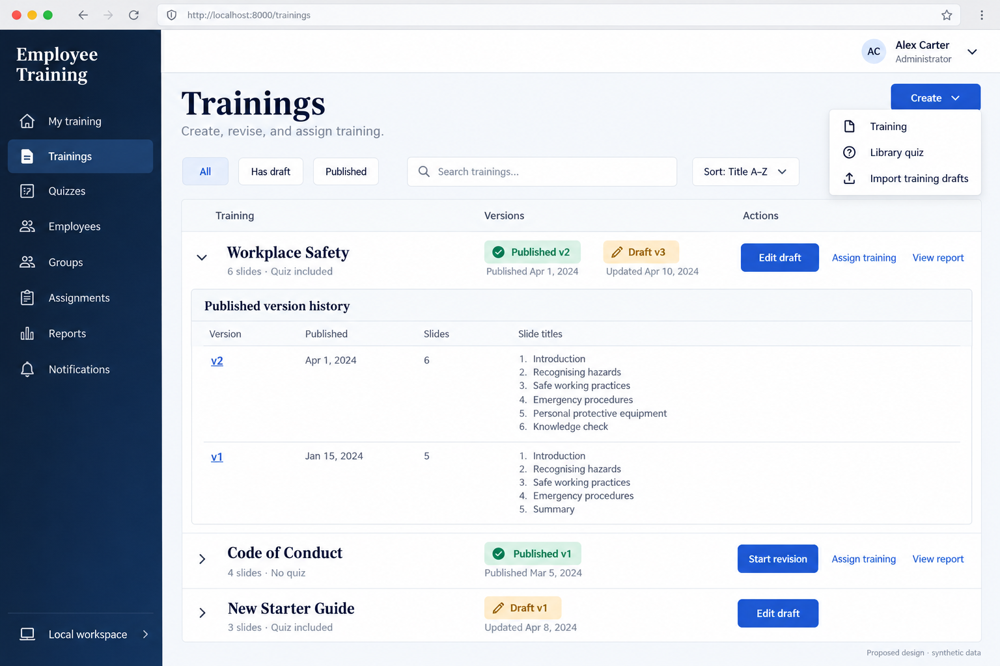
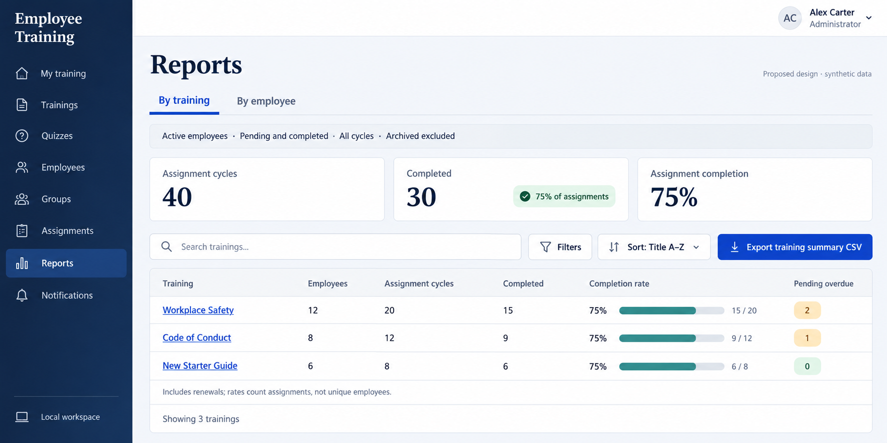
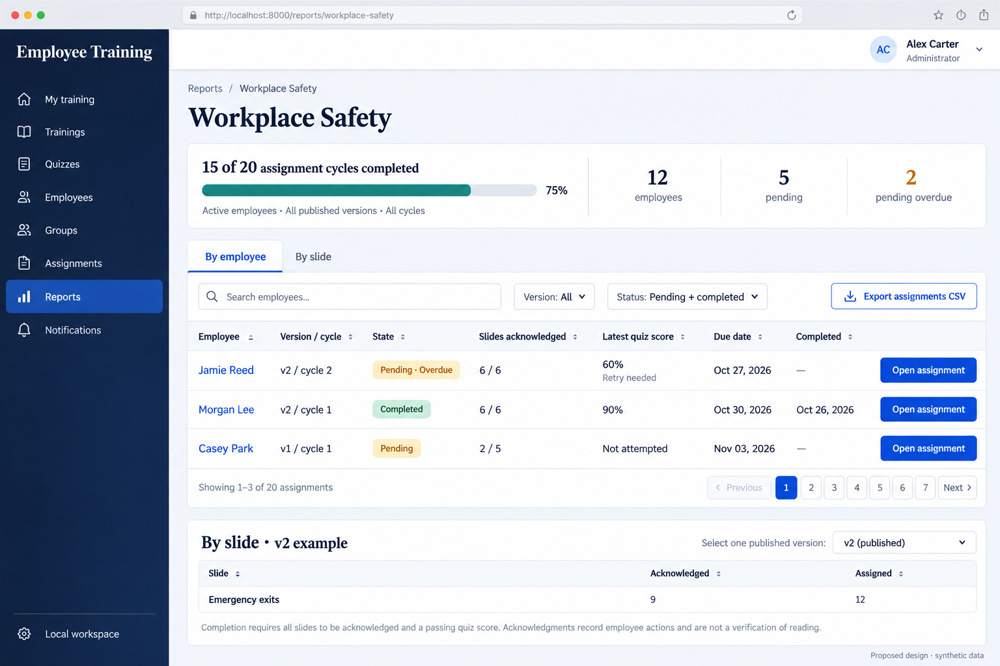
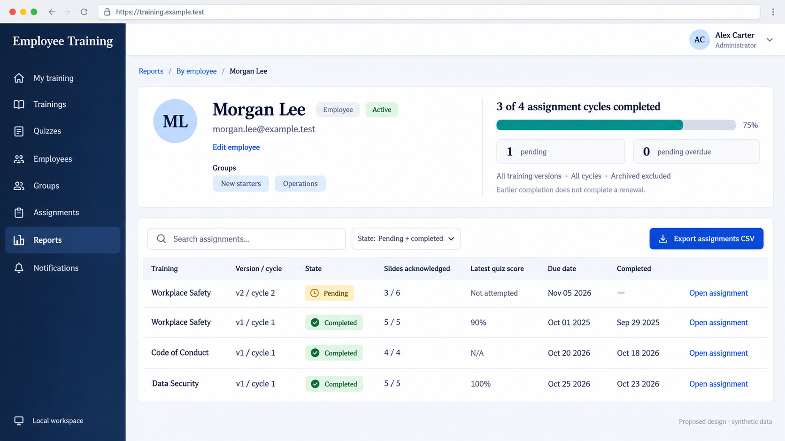
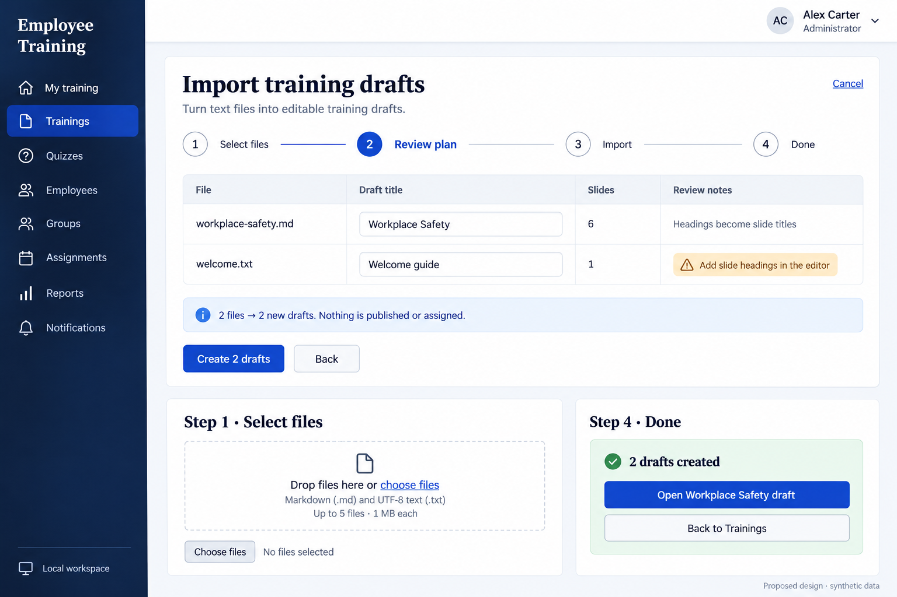

# Training library and report concepts

Five proposed screens adapt the [reference screenshots](../../screenshots/) to the current Employee Training app. The [implementation plan](../../plans/library-and-reports.md) defines the delivery slices, report calculations, routes, and acceptance checks.

These are imagegen design concepts with synthetic data. Reports and import are proposed additions. Browser addresses, dates, pagination, and sample records are illustrative; use the plan's UUID routes and existing pagination behavior. Each image illustrates its own example population. Insets show alternate tabs or workflow steps rather than panels that must all appear at once.

## Training library and creation menu

Keep the canonical title and both publication states visible. Actions map to existing training and library quiz creation, draft editing, publication history, and assignment workflows. Add View report and Import training drafts when those routes ship. Counts describe a labeled version; do not imply one count covers both a published version and a changed draft. Preserve renewal actions where applicable.

## Reports overview

Completion is a ratio of assignment counts, including renewal cycles. The 30 completed cycles out of 40 produce 75%; distinct employees are a separate measure. By employee uses the same report population. Search applies to employee name/email and assigned version title; the implemented placeholder should say “Search reports” rather than the narrower wording in the concept.

## Training report

Keep assigned version and cycle beside each employee. A failing quiz remains pending even when every slide has been acknowledged. By slide requires one published version; the lower panel illustrates that alternate tab. Completion requires all slide acknowledgments and, **when a quiz is included**, a passing attempt. The slide summary measures acknowledgments, not verified reading.

## Employee report

Show the identity and activity data the app already stores. Keep repeated training assignments visible across cycles, and link profile editing separately. Current group membership supplies context; it does not determine historical assignments.

## Import training drafts

The first implementation supports Markdown and UTF-8 text, one new training draft per file. The review panel is the main screen; the smaller panels illustrate Select files and Done. The implemented review also includes slide previews, file removal, and file-specific errors. Draft creation uses the existing editor limits and publication checks.

## Generation record

Generated on 2026-10-28 with the built-in `image_gen` tool through the imagegen skill. The [exact five prompts](prompts.json) specify the current stylesheet's final theme, domain rules, synthetic examples, and excluded features. These are new generated concepts, not edits of the source screenshots or captures of an implemented interface.
