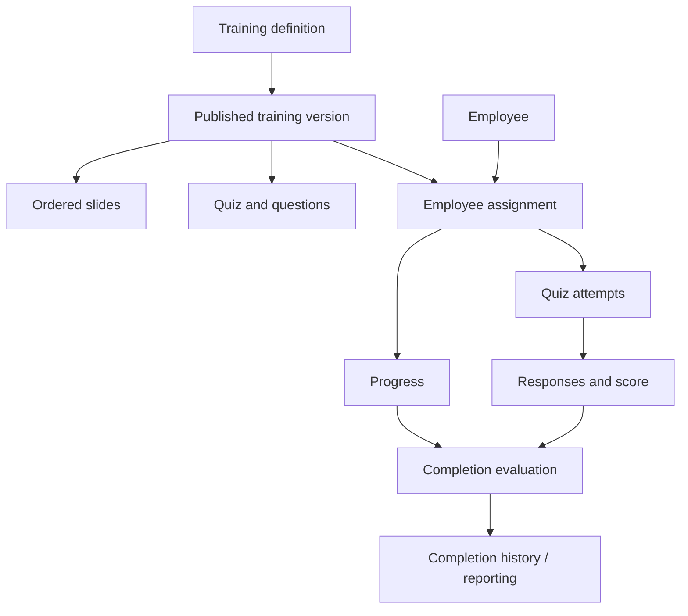

# Employee Training Management System

**Document type:** Preliminary Software Requirements and Architecture Design  
**Status:** Confirmed MVP requirements baseline  
**Date:** October 26, 2026  

> **Authentication update, October 28, 2026:** The [email and password authentication plan](plans/email-password-authentication.md) supersedes the provider-managed sign-in, provider account-binding, and no-self-registration requirements below. The new direction allows employee registration subject to administrator approval and administrator-created employee records. It is implemented locally ([Slice 29](plans/29-sign-in-skeleton.md) and [Slice 31](plans/31-real-employee-workflows.md)); email delivery and [production deployment](plans/30-production-deployment.md) remain.

## 1. Executive Summary

This document consolidates the initial user stories, sketches, and data-model brainstorming for an internal employee training management application. The system enables administrators to create and assign training, establish deadlines, track completion, and send reminders. Employees can review assigned material, complete quizzes, and monitor their progress.

The central architectural principle is to separate training definitions, training assignments, and training execution records. A training defines what is learned; an assignment identifies who must complete which published version and by when; attempts and completion records capture what happened.

> **System definition:** An employee training management system assigns versioned learning requirements to employees, evaluates fulfillment, and preserves an auditable record of the results.

## 2. Product Scope and Roles

### 2.1 User roles

The MVP serves one organization. Administrators have organization-wide access and can also receive training through their individual employee identities.

Administrators create employee records before sign-in. Employees sign in with an email address and password. An operator command creates the first administrator, and employees may also register themselves, subject to administrator approval. Employee identity persists through name/email changes, which are recorded in profile history; ordinary reports show current names.

Initial sign-in linking requires a provider-verified email matching an active, unlinked employee record. Subsequent sign-in uses the provider's stable account identity; changing email never transfers that binding to a different person.

- Administrator: Creates and publishes training, manages employees and assignments, sets deadlines, monitors progress, and sends reminders.
- Employee: Views assigned training, reviews slides, completes quizzes, and sees personal completion status.

### 2.2 Capability matrix

| Capability | Administrator | Employee |
| --- | --- | --- |
| Training content | Create, edit, publish | View assigned training |
| Quizzes | Define questions, answers, passing criteria | Submit answers and review results |
| Assignments | Assign training and deadlines | View assignments and due dates |
| Progress | Monitor organization-wide status | View personal progress |
| Notifications | Set assignment deadlines and send nudges under fixed reminder rules | Receive assignment and deadline emails |
| Completion | Review evidence and reports | View completion and passing status |

### 2.3 Requirements derived from initial notes

1. Training contains ordered slides.
2. Training can include a corresponding quiz.
3. Supported question formats include single-choice, multiple-selection, true/false, and ordering.
4. Passing a quiz requires meeting a configured minimum score.
5. Administrators assign training to employees with due dates.
6. Employees receive email notifications for new assignments.
7. Reminder emails are sent three days before and on the due date.
8. Administrators can monitor employee progress and completion.
9. Administrators can manually nudge employees with pending training.
10. Training content is manually authored; quiz-question creation is part of the authoring interface.
11. Deadline changes queue an immediate email with the new date.

The confirmed policies below refine the initial requirements. Technology setup and real-data readiness remain explicit implementation gates; see Section 9.

## 3. Domain Architecture

The application has three principal domains.

### 3.1 Training content

Defines reusable learning material and assessments:

- Training metadata (title, description)
- Published training versions
- Ordered slides (header, body, optional footer)
- Library quizzes and quizzes attached to training versions
- Answer options, correct-answer rules, and passing thresholds

Content exists independently of any particular employee or assignment. A published version should be immutable to preserve the exact material an employee was assigned.

### 3.2 Assignment management

Defines the obligation to complete training:

- Employee
- Published training version
- Assignment timestamp
- Due date
- Administrative status (active, canceled, or archived)

One published training version can be assigned to many employees. A bulk-assignment action should create individual assignment records, rather than duplicating the training content.

### 3.3 Execution and compliance

Records how an employee fulfills an assignment:

- Slide acknowledgments and resume position
- Quiz attempts
- Submitted responses and scores
- Passing/failing outcomes
- Completion timestamp
- Deadline compliance and notification history

The separation prevents mutable content, administrative assignments, and historical outcomes from being conflated.

### 3.4 Conceptual workflow



## 4. Proposed Relational Data Model

The initial sketch proposed Question(type, answers), Quiz(questions), Training(slides, quiz), Assignments(employee, dueDate, training), and Employee(name, role, email, completedAssignments).

These are useful conceptual entities, but collections and derived relationships should generally be represented through separate tables and foreign keys rather than embedded attributes.

### 4.1 Core entities

| Entity | Representative fields | Purpose |
| --- | --- | --- |
| `employees` | `id`, `name`, `email`, `role`, `active` | Identity and authorization role |
| `trainings` | `id`, `title`, `description` | Logical training identity |
| `training_versions` | `id`, `training_id`, `version`, `status`, `published_at` | Draft/published snapshot |
| `slides` | `id`, `version_id`, `position`, `header`, `body`, `footer` | Ordered training content |
| `quizzes` | `id`, optional `version_id`, `title`, `revision`, `passing_score` | Library quiz or independent training-version copy |
| `questions` | `id`, `quiz_id`, `type`, `prompt`, `position` | Quiz items |
| `question_options` | `id`, `question_id`, `label`, `position`, `is_correct` | Selectable options; ordering needs additional answer-order rules |
| `assignments` | `id`, `employee_id`, `version_id`, `assigned_at`, `due_date`, `due_time_zone`, `due_at`, `completed_at`, `canceled_at`, `archived_at` | Individual training obligations; `due_at` is the exclusive UTC boundary after the selected local due date |
| `quiz_attempts` | `id`, `assignment_id`, `score`, `passed`, `submitted_at` | Immutable assessment attempts |
| `attempt_responses` | `id`, `attempt_id`, `question_id`, `response` | Submitted answers for review and scoring |

Implementation note: The fields above are conceptual, not a complete production DDL. Add foreign keys, uniqueness constraints, timestamps, and indexes. For multiple-selection and ordering questions, use type-specific grading configuration and structured responses; a single is_correct flag is not sufficient for all formats.

### 4.2 Relationships

- One training has many training_versions.
- One training_version has many slides.
- One training_version has zero or one attached quiz. Library quizzes exist independently and can be copied into multiple drafts.
- One quiz has many questions.
- One question may have many question_options.
- One employee has many assignments.
- One training_version has many assignments.
- One assignment has many quiz_attempts.
- One quiz_attempt has many attempt_responses.

### 4.3 Do not duplicate completed assignments on employees

Avoid persisting Employee.completedAssignments as a second source of truth. Query completed assignments using assignments.completed_at and associated outcome records. This reduces inconsistency and simplifies reporting.

### 4.4 Slide ordering: position instead of linked-list pointers

The sketches represent slides as S0 → S1 → S2. This is an effective user-interface metaphor, but it does not require a database-level linked list.

Store an integer position:

| slide_id | version_id | position | header |
| --- | --- | --- | --- |
| 101 | 7 | 0 | Introduction |
| 102 | 7 | 1 | Security Policies |
| 103 | 7 | 2 | Incident Reporting |

```sql
SELECT *
FROM slides
WHERE version_id = 7
ORDER BY position;
```

Consider a unique constraint on (version_id, position) and transactional reorder operations. This is simpler than maintaining next_slide_id pointers.

## 5. Assignment Lifecycle

Progress, deadline compliance, and administrative disposition should be modeled as distinct dimensions.

### 5.1 Progress states

- not_started
- in_progress
- completed

### 5.2 Deadline status

- on_time (before the deadline boundary while incomplete, or completed before that boundary)
- overdue (at or after the deadline boundary and incomplete)
- completed_late (completed at or after the deadline boundary)

Deadline status is typically derived from due_at, completed_at, and current time, rather than stored as a competing primary state.

### 5.3 Administrative status

- active
- canceled

Waivers and administrative completion overrides are outside the MVP.

An employee may be simultaneously in progress and overdue. This should not erase their progress.

### 5.4 Example

```yaml
assignment:
  employee: Alice
  training: Data Security
  version: 2
  due_date: 2026-10-30
  progress: in_progress
  deadline_status: overdue  # example evaluated after due date
  latest_score: 70
  passing_score: 80
```

The due date includes its entire calendar day in the configured organization time zone. Preserve that date and time zone; store `due_at` as the exclusive start of the following local day converted to UTC. Completion before the boundary is on time; at or after it is late. Newly selected due dates must be today or later; existing overdue work remains accessible. Deadline edits apply only to active, incomplete assignments, recompute current status, and preserve old/new values, actor, and time; completed deadlines remain fixed. An actual deadline change immediately queues a notification with the new date. Completion criteria are evaluated server-side.

## 6. Refined User Stories and Acceptance Criteria

### Epic A: Content Management

#### US-01 — Create training

As an administrator, I want to create training so that I can organize material employees need to learn.

**Acceptance criteria:**

- Admin can create and edit a draft training with a title and description.
- A training can contain multiple slides.
- Draft content is not automatically assigned or published.
- Incomplete drafts can be saved with actionable validation problems; structurally invalid data is rejected on save, and incomplete content blocks publication.

#### US-02 — Manage slides

As an administrator, I want to create, edit, remove, and reorder slides so that training is presented sequentially.

**Acceptance criteria:**

- Each slide has a header, body, and optional footer.
- Slide content is plain text with paragraphs and line breaks preserved; formatting tools and media are outside the MVP.
- Slide ordering is deterministic.
- Slide edits and reorder operations are saved consistently.

#### US-03 — Create quizzes

As an administrator, I want to add quiz questions and configure a passing threshold so that understanding can be assessed.

**Acceptance criteria:**

- Supports single-choice, multiple-selection, true/false, and ordering formats.
- Each question includes valid grading rules for its type.
- Passing threshold is a validated whole percentage from 1 through 100.
- A quiz cannot be published with invalid or ungradable questions.
- Incomplete questions can be saved and resumed without satisfying publication requirements.
- Administrators can author a library quiz separately and attach a copy of a complete, titled quiz to a training draft. Later changes to either copy do not change the other.
- Replacing an attached draft quiz requires confirmation. Training publication still validates its saved quiz copy.

#### US-04 — Publish versions

As an administrator, I want to publish a training version so that assigned employees receive stable content.

**Acceptance criteria:**

- Published versions are immutable.
- Editing published content creates a new draft/version.
- Existing assignments retain their original version. Replacing unfinished training requires explicit cancellation and a new assignment; the prior assignment and its evidence remain intact.

### Epic B: Assignment Management

#### US-05 — Assign training

As an administrator, I want to assign a published training version to one or more employees with due dates.

**Acceptance criteria:**

- Each employee receives an individual assignment record.
- Assignment stores employee, training version, assignment time, and due date.
- A newly selected due date must be today or later in the organization time zone.
- At most one active, incomplete assignment exists per employee and logical training, across versions. Replacing unfinished training requires explicit cancellation before the new assignment is created.
- Deactivation preserves an employee's outstanding assignments and history while rejecting access and new assignments; it does not complete or cancel training.
- Reactivation restores access to active assignments with unchanged progress and deadlines. It creates no new assignment, deadline extension, or assignment email.
- Replacement uses separate Cancel and Assign actions: require a cancellation reason, then select the replacement version and deadline. Its progress starts from zero; the old evidence remains intact.
- An administrator can archive an assignment with a reason. Archiving unfinished work cancels it first; restoration changes visibility only and never restarts that obligation. Progress, attempts, and notification records are preserved.

#### US-06 — Assignment notifications

As an employee, I want to receive an email when training is assigned so that I know what to complete.

**Acceptance criteria:**

- Assignment creation schedules a notification.
- Email identifies the training and deadline.
- Notification failures do not roll back a valid assignment.
- Before dispatch and each retry, suppress unsent assignment emails for completed/canceled work or inactive employees and record the reason.

#### US-07 — Deadline reminders

As an employee, I want reminders before my training is due so that I can complete it on time.

**Acceptance criteria:**

- Reminder scheduled at 09:00 in the organization time zone three calendar days before the due date.
- Another reminder scheduled at 09:00 in the organization time zone on the due date.
- Reminder rules are fixed for the MVP; administrators adjust assignment deadlines rather than configuring reminder policies.
- Completed or canceled assignments do not receive further scheduled reminders.
- Inactive employees do not receive reminders.
- Changing the due date updates future reminders.
- An actual deadline change also queues an immediate deadline-change email using the shared delivery queue and eligibility checks. Saving an unchanged date sends no change notification.
- Delivery attempts and outcomes are recorded.
- For newly created assignments, skip elapsed reminder times, retain future ones, and queue the assignment email immediately.
- On scheduler recovery, send at most the latest eligible missed scheduled reminder. The due-day reminder supersedes the three-day reminder, and both expire at the assignment's deadline.
- Reactivation resumes only future scheduled reminder times, with no catch-up for times missed while inactive. After the deadline, follow-up uses manual nudges.

### Epic C: Employee Experience

#### US-08 — View assigned training

As an employee, I want to see my assigned training, due dates, and status so that I can prioritize my work.

**Acceptance criteria:**

- Employees can only see their own assignments unless their role permits otherwise.
- Assignments show progress and deadline status.
- Employees can open the correct published training version.

#### US-09 — Complete training

As an employee, I want to acknowledge the training slides and pass the associated quiz when one is included so that I can satisfy the training requirement.

**Acceptance criteria:**

- Slides appear in defined order.
- Employees may navigate freely; navigation alone does not acknowledge a slide. Preserve acknowledgments and resume position.
- Every slide requires an explicit acknowledgment, which records the employee's action without establishing attention or comprehension.
- Training without a quiz completes when every slide is acknowledged. Training with a quiz also requires a passing attempt.
- Quiz submission is validated and graded server-side.
- All slides must be acknowledged before quiz submission.
- Each attempt is recorded separately.
- Passing an assessment completes the assignment once every slide has been acknowledged.

#### US-10 — Retry assessment

As an employee, I want to retry a failed quiz until I pass so that I can satisfy the assessment requirement.

**Acceptance criteria:**

- Unlimited retries are allowed until completion; new attempts after completion are rejected.
- Earlier attempts are preserved.
- Completion is recorded only when configured criteria are satisfied.
- Employees can review submitted answers, overall score, pass/fail, and attempt history. Correct answers, per-question correctness, and grading configuration are withheld, including after completion.

### Epic D: Administration and Reporting

#### US-11 — Monitor progress

As an administrator, I want to view pending, completed, and overdue training assignments so that I can identify follow-up needs.

**Acceptance criteria:**

- Dashboard supports filtering by employee, training, and status.
- Completion timestamps and relevant scores are available.
- Reporting uses assignment and attempt records as authoritative data.
- The default actionable-work view excludes inactive employees. Their assignments and evidence remain available through an explicit activity filter; cancellation remains a separate action.
- Archived assignments are excluded from routine lists and available through an explicit administrator archive filter. Completed archived work can be restored to the learner's completed list.

#### US-12 — Send manual nudge

As an administrator, I want to remind an employee about incomplete training so that I can encourage timely completion.

**Acceptance criteria:**

- Admin can trigger a reminder for an eligible assignment.
- The system records who triggered the nudge and when.
- At most one manual nudge request is accepted per assignment in a rolling 24 hours, enforced across administrators.
- Manual nudges leave scheduled reminders unchanged; show the upcoming scheduled reminder beside the action. Scheduled and manual messages may arrive close together.

## 7. System Behavior and Technical Principles

### 7.1 Versioned content

Treat training definitions as reusable content, and published versions as immutable snapshots. A new version should not silently change historical assignments, grades, or completion evidence.

### 7.2 Quiz grading

Use a common question interface with type-specific validation and grading:

- Single-choice: One selected option equals the correct option.
- Multiple-selection: Compare selected option set to the correct set by exact equality.
- True/false: Compare a boolean response with the correct value.
- Ordering: Compare the submitted sequence against the required sequence by exact equality.

Questions have equal weight and receive no partial credit. Compare the unrounded percentage inclusively with the integer passing threshold from 1 through 100; round only for display. Preserve sufficient submitted-answer and grading information for administrative review, while learner results show only submitted answers, overall score, pass/fail, and history. Unlimited retries may allow answer inference despite withholding answer keys.

### 7.3 Notifications

Notification delivery should be asynchronous. Creating an assignment should commit the database transaction independently from sending email. A durable queue or transactional outbox can support retries and delivery tracking. Ensure jobs are idempotent to prevent duplicate reminders.

Assignment creation and actual deadline changes persist their notification intents with the associated data changes; email is dispatched only after commit. Before dispatch and retries, verify the assignment remains active and incomplete and the employee remains active. Use the current verified recipient address and current deadline, together with the title from the assigned immutable version; preserve the recipient and content actually sent. A missing verified address blocks delivery rather than sending to an obsolete or unverified address. Obsolete deadline-change revisions and expired scheduled reminders are suppressed with recorded outcomes.

### 7.4 Auditability

For each completion, preserve:

- Stable employee identity, with audited name/email changes and current names in ordinary reports
- Assigned training version
- Due date and completion timestamp
- Quiz score and pass/fail outcome
- Attempt history under the approved retention policy
- Administrative changes, including deadline edits and cancellation

Passing an assessment establishes that configured criteria were met; it does not necessarily establish long-term knowledge retention.

### 7.5 Security and permissions

- Enforce authorization on the server, not only in the interface.
- Employees access only their permitted assignments and results.
- Administrators receive appropriate organization-level permissions.
- Validate quiz submissions and protect answer keys.
- Apply reasonable retention and privacy controls to employee records.
- Before introducing real employee data, name an operational owner and approve employee-data retention/access rules. Until then, use demonstration data and preserve evidence; automatic deletion requires an approved policy and implementation scope.

## 8. Suggested MVP and Build Order

The [implementation plan](implementation-plan.md) refines these broad phases into eight demonstrable slices. Early slices are for demonstrations and testing; live employee use starts after all eight slices and the release criteria are complete. Deploy a working skeleton in Slice 1 to validate the deployment, authentication, and background-job constraints early.

The initial deployment consists of one application, one relational database, and a background worker from the same codebase. Select and record the framework, database, identity provider, hosting, email provider, and organizational constraints during setup before building the Slice 1 authoring workflow. Verify deployment, authentication, migrations, and background execution in that slice.

### Phase 1 — Content model

Build training, versions, slides, quizzes, questions, options, ordered slide retrieval, and grading. A simple administrator interface is sufficient.

### Phase 2 — Employees and assignments

Add employees, role checks, individual assignment records, and due dates.

### Phase 3 — Employee workflow

Implement assignment listing, slide navigation, quiz submissions, attempt history, and completion evaluation.

### Phase 4 — Administrator reporting

Add an assignment dashboard with pending, completed, and overdue filters, plus employee-level results.

### Phase 5 — Notifications

Add initial assignment emails, immediate deadline-change emails, scheduled deadline reminders, manual nudges, retry handling, and delivery logs.

Defer initially: formatting tools and media, complex permission hierarchies, extensive analytics, elaborate content templates, and sophisticated reporting exports.

## 9. Design Decisions

The requirements and implementation sequence were confirmed as the MVP baseline on October 26, 2026, incorporating all 27 policy and planning decisions. The [implementation plan](implementation-plan.md#planning-assumptions-and-decisions) maintains the confirmed policy table and explicit implementation gates; [GLOSSARY.md](GLOSSARY.md) defines the shared terms. The accepted gates require stack selection and deployment proof in Slice 1, a named operational owner and approved retention/access policy before real employee data, and full production-readiness checks before live use. These operational choices are intentionally deferred to their stated gates rather than left as unresolved product behavior.

## 10. Longer-Term Product Direction

The system can evolve in two directions:

1. Learning management: Better authoring, assessments, feedback, learner engagement, and knowledge retention.
2. Compliance and accountability: Stronger audit trails, reporting, deadline enforcement, recurring certifications, and administrative oversight.

The underlying data model supports both, but the primary product goal should determine what to prioritize after the MVP.

## 11. Summary

The original brainstorming is reconciled by distinguishing:

1. Definition: Reusable, versioned training with slides and an optional assessment.
2. Obligation: An assignment linking an employee to a specific version and deadline.
3. Evidence: Progress, quiz attempts, scores, and completion history.

This separation provides a normalized foundation for content reuse, accurate employee tracking, deadline notifications, and audit-ready reporting without introducing unnecessary complexity into the first implementation.
